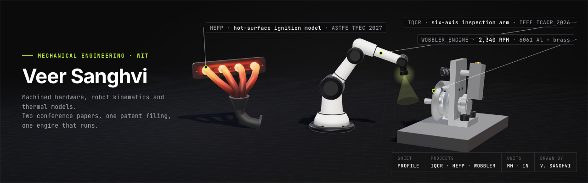

  

Mechanical Engineering student at Wentworth Institute of Technology, Boston. Currently on a Manufacturing &amp; Operations Co-op at Moveras, LLC. Co-author of two conference papers: one published at IEEE ICACR 2026, one accepted to ASTFE TFEC 2027.

  <a href="https://veer-sanghvi.github.io">Portfolio</a> &nbsp;&middot;&nbsp;
  <a href="https://www.linkedin.com/in/veer-sanghvi/">LinkedIn</a> &nbsp;&middot;&nbsp;
  <a href="mailto:veersan25@gmail.com">Email</a> &nbsp;&middot;&nbsp;
  <a href="https://github.com/Veer-Sanghvi/wobbler-engine">Top project</a>

<h3 align="center"><code>veer@github ~ $ whoami</code></h3>

  

Designed a fire suppression system with heat-based leak detection during an internship (NDA, company not disclosed); the parent company filed a patent on it.

Built and machined hardware: a wobbler engine that runs at 2,340 RPM, a remote-controlled scissor lift designed for uneven terrain, and a 3D-printed rover for ASME's IAM3D challenge.

---

### Publications

- V. Sanghvi et al. (2026). Inspection and Quality Control Robots. IEEE ICACR 2026, Nanjing, China. [Paper PDF](https://veer-sanghvi.github.io/IQCR/conference_paper/IQCR_camera_ready_6page.pdf) and [live simulation](https://veer-sanghvi.github.io/IQCR/).
- V. Sanghvi et al. (2027). Hot Engines and Fire Prevention. ASTFE Thermal and Fluids Engineering Conference (TFEC 2027), Dallas, TX. Accepted, to appear; [live simulation](https://veer-sanghvi.github.io/HEFP/).

### What I have built

<table>
  <tr>
    <td width="50%" valign="top">
      <b><a href="https://veer-sanghvi.github.io/#fire-suppression">Fire suppression system with heat-based leak detection</a></b> 
      SolidWorks &middot; manufacturing drawings &middot; NDA  
      Designed during an internship (NDA, company not disclosed); full assembly model and manufacturing drawings in SolidWorks.  
      <b>Result.</b> The parent company filed a patent on the design. Details under NDA.
    </td>
    <td width="50%" valign="top">
      <b><a href="https://github.com/Veer-Sanghvi/wobbler-engine">High-Speed Wobbler Engine</a></b> 
      6061 Al &middot; brass &middot; sand casting &middot; lathe and mill  
      Air-powered single-cylinder oscillating engine; sand casting, machining, and tolerance analysis.  
      <b>Result.</b> Stable operation at 2,340 RPM.
    </td>
  </tr>
  <tr>
    <td width="50%" valign="top">
      <b><a href="https://veer-sanghvi.github.io/IQCR/">IQCR: Inspection &amp; Quality Control Robots</a></b> 
      6-axis kinematics &middot; camera, depth sensor, laser probe &middot; browser solver  
      Kinematic feasibility study for a 6-axis robot arm combining camera, depth sensor, and laser probe for in-line inspection; live 3D solver demo in the browser.  
      <b>Result.</b> Accepted, IEEE ICACR 2026 (Nanjing, China, Oct 2026).
    </td>
    <td width="50%" valign="top">
      <b><a href="https://veer-sanghvi.github.io/HEFP/">HEFP: Hot Engines &amp; Fire Prevention</a></b> 
      1-D thermal model &middot; exhaust manifold wall &middot; browser solver  
      One-dimensional screening model of hot-surface ignition risk on an exhaust manifold wall, with a live browser solver.  
      <b>Result.</b> Paper accepted, ASTFE TFEC 2027 (Dallas, Mar 2027).
    </td>
  </tr>
  <tr>
    <td width="50%" valign="top">
      <b><a href="https://veer-sanghvi.github.io/xflex">X-FLEX Compact Lift</a></b> 
      Senior capstone &middot; Arduino control &middot; 6-person team  
      Remote-controlled scissor lift designed for load transport on uneven terrain (outdoor terrain was not validated); I worked on the Arduino-based control development with the 6-person team.  
      <b>Result.</b> Completed; presented at Wentworth's Senior Capstone Showcase.
    </td>
    <td width="50%" valign="top">
      <b><a href="https://veer-sanghvi.github.io/rover">ASME IAM3D R.O.V.E.R</a></b> 
      3D-printed &middot; remote-operated &middot; WIT ASME club team  
      Remote-operated excavation vehicle built by WIT's ASME club team for ASME's additive manufacturing challenge; as one of the seniors on a team of sophomores and juniors, I floated across the movement, manipulator, and frame subsystems.  
      <b>Result.</b> The team placed 5th at the ASME EFx competition.
    </td>
  </tr>
</table>

#### Code

| Project | What it is | Result |
|---|---|---|
| [pressfit](https://github.com/Veer-Sanghvi/pressfit) | ISO 286 limits and fits from the terminal; zero dependencies, and the test suite is built from published fit-table rows. | Live on [PyPI](https://pypi.org/project/pressfit/): pip install pressfit. |
| [guzzler](https://github.com/Veer-Sanghvi/guzzler) | Fuel consumption model with LightGBM monotone constraints, so it cannot predict a heavier car burning less fuel. | Beats the linear baseline on 18 of 20 splits; the physics guarantee costs about 6 percent accuracy. |
| [restock](https://github.com/Veer-Sanghvi/restock) | Demand forecasting scored in safety stock at 95 percent service, backtested against the baselines a stockroom already uses. | The moving average won and the README says so; forecast choice frees about 4,500 units of stock. |

### Background

- Ran 50+ pressure, leak, and reliability tests to IS, UL, and FM standards across two roles in fire protection manufacturing.
- Managed inventory of 500+ fire-protection SKUs across two factory floors at Eurotech Cylinders.
- Built and tuned LightGBM models in Python on automotive and supply-chain datasets at Corizo.

### Tools

  
  
  
  
  
  
  
  
  

The banner is rendered from <code>assets/readme/scene/</code> (three.js, headless Chromium); the info card from <code>scripts/make_info_card.py</code>.
